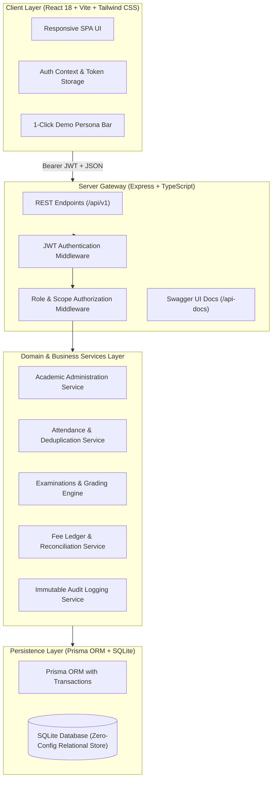
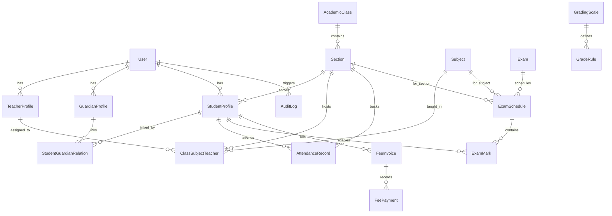

# 🎓 Algions School Management System (SMS)
### Full-Stack Web Development | Advanced Individual Project Assessment
**Organization**: ALGIONS AI LABS PRIVATE LIMITED  
**Role**: Full-Stack Web Development  
**Domain**: School Management System  
**Submission Package**: Production-Ready Modular Monolith (Node.js, Express, TypeScript, Prisma ORM, SQLite, React 18, Tailwind CSS, Jest, Swagger UI)

---

## 📌 Executive Summary

The **Algions School Management System** is a responsive, database-backed enterprise web application designed to support the mission-critical operations of a modern educational institution. The solution delivers end-to-end user journeys for operational staff (**Administrators**, **Teachers**) and end-users (**Guardians**, **Students**), backed by strict server-side authorization, atomic transaction boundaries, composite deduplication indexes, and an immutable audit trail.

---

## 🌟 Demonstration of Acceptance Tests

All 5 assessment acceptance tests are fully implemented, verified via automated test suites, and demonstrable in the UI:

| # | Acceptance Criterion | Server-Side Implementation | Test Verification |
|---|---|---|---|
| **1** | **Teacher Class Scope Restriction** | `verifyTeacherSectionAccess` middleware checks `ClassSubjectTeacher` database allocation before allowing attendance/marks access. | **`tests/acceptance.test.ts`**: Teacher Sarah Connor accesses assigned class Grade 10-A (200 OK) and is rejected with 403 Forbidden for unassigned class Grade 10-B. |
| **2** | **Attendance Deduplication & Safe Updates** | Database Composite Unique Constraint `@@unique([studentId, date, session])` coupled with atomic `prisma.$transaction` batch upsert. | **`tests/acceptance.test.ts`**: Duplicate submissions with `allowUpdate=false` are rejected with `409 Conflict`. Safe updates overwrite existing records cleanly without duplicate rows. |
| **3** | **Exam Result & Grade Calculation** | Pure TypeScript grading engine (`gradingEngine.ts`) evaluates student marks against configurable grading scale cutoffs (A+, A, B+, B, C, D, F), computing weighted percentage, GPA, and pass/fail status. | **`tests/acceptance.test.ts`**: Exact calculations tested: total marks, overall percentage (88.33%), grade assignment ('A'), GPA (3.7), and multi-subject transcript generation. |
| **4** | **Guardian Multi-Tenant Privacy Isolation** | `verifyGuardianStudentAccess` middleware dynamically verifies `StudentGuardianRelation` records. Cross-student queries are strictly forbidden. | **`tests/acceptance.test.ts`**: Guardian Robert Stark accesses linked child Arya Stark's report card (200 OK), but receives 403 Forbidden when requesting Bruce Wayne's records or fee invoices. |
| **5** | **Fee Due & Paid Reconciled with Ledger** | Atomic `prisma.$transaction` payment processing updates invoice `amountPaid` and `amountDue`, asserts ledger reconciliation (`amount == amountPaid + amountDue`), and records immutable payment receipts. | **`tests/acceptance.test.ts`**: Partial payments reconcile balances, overpayments are rejected with 400 Bad Request, full settlement marks invoice as PAID, and system ledger reconciles with zero discrepancies. |

---

## 🏗️ Architecture & High-Level Design



---

## 🗄️ Relational Database Schema (ER Diagram)



---

## 🔑 Demo Reviewer Credentials

The database is pre-seeded with synthetic test records. Reviewers can log in manually or use the **1-Click Reviewer Persona Switcher** in the application header:

| Role | Name | Email | Password | Assigned Permissions / Linked Scope |
|---|---|---|---|---|
| **ADMIN** | Dr. Arthur Vance | `admin@school.demo` | `Password@123` | Universal administrative access, class creation, teacher assignment, full ledger reconciliation, system audit logs. |
| **TEACHER** | Sarah Connor | `teacher@school.demo` | `Password@123` | Assigned to **Grade 10-A (Mathematics)** and **Grade 9-B (Mathematics)**. Records attendance, enters marks. Denied access to 10-B. |
| **TEACHER** | Dr. Bruce Banner | `teacher.science@school.edu` | `Password@123` | Assigned to **Grade 10-A (Science & Chemistry)**. |
| **GUARDIAN** | Robert Stark | `guardian@school.demo` | `Password@123` | Linked to **Arya Stark (10-A)** & **Bran Stark (9-B)**. Denied access to Bruce Wayne's records. |
| **GUARDIAN** | Martha Wayne | `guardian.wayne@school.edu` | `Password@123` | Linked to **Bruce Wayne (10-A)**. |
| **STUDENT** | Arya Stark | `student.arya@school.edu` | `Password@123` | Grade 10-A student portal. Personal attendance, report card transcript, fee ledger. |

---

## 🚀 Quick Start / Local Setup Instructions

### Prerequisites
- **Node.js**: v18+ (tested on Node.js v22.20.0)
- **npm**: v9+ (tested on npm 11.1.0)
- No external database installation required (uses embedded relational SQLite).

### 1. One-Command Setup
Install all dependencies across backend and frontend, generate Prisma client, sync the SQLite database schema, and seed synthetic demo data:
```bash
npm run setup
```

### 2. Run Automated Acceptance Tests
Execute the complete test suite verifying all 5 core acceptance criteria, role boundaries, idempotency, and negative/conflict edge cases:
```bash
npm test
```
*Expected result: 18/18 tests pass with 100% green status.*

### 3. Start the Development Servers
Launch both the Express backend API (`http://localhost:5000`) and the Vite React frontend (`http://localhost:5173`) concurrently:
```bash
npm run dev
```

Open your browser to:
- **Web Application**: `http://localhost:5173`
- **Swagger / OpenAPI Documentation**: `http://localhost:5000/api-docs`

---

## 🧪 Automated Test Suite Breakdown

The test suite (`backend/tests/acceptance.test.ts`) provides full automated evidence for the evaluation rubric:

```
PASS tests/acceptance.test.ts
  Algions School Management System - Core Acceptance Test Suite
    Acceptance Test 1: Teacher can access only assigned classes
      √ allows teacher Sarah Connor to access assigned section Grade 10-A attendance sheet (200 OK)
      √ rejects teacher Sarah Connor from recording/accessing unassigned section Grade 10-B (403 Forbidden)
    Acceptance Test 2: Duplicate attendance prevention and safe updates
      √ records attendance batch cleanly for an assigned section
      √ rejects duplicate attendance when allowUpdate is false (409 Conflict)
      √ safely updates existing attendance when allowUpdate is true without creating duplicate DB rows
    Acceptance Test 3: Exam marks, percentages and grading calculation rules
      √ calculates correct letter grade and GPA based on score percentage
      √ compiles full student report card with weighted totals and overall status
    Acceptance Test 4: Guardian privacy and multi-tenant student isolation
      √ allows guardian Robert Stark to access linked student Arya Stark report card (200 OK)
      √ strictly forbids guardian Robert Stark from accessing unlinked student Bruce Wayne report card (403 Forbidden)
      √ strictly forbids guardian Robert Stark from viewing Bruce Wayne fee invoices (403 Forbidden)
    Acceptance Test 5: Fee invoices, payments, and ledger reconciliation
      √ creates a new fee invoice with zero paid and exact due balance
      √ records a partial simulated payment and reconciles invoice balance
      √ rejects an overpayment that exceeds the remaining balance (400 Bad Request)
      √ settles remaining balance and marks invoice as fully PAID
      √ verifies system-wide fee ledger reconciliation has zero discrepancies
    Negative & Security Edge Cases
      √ rejects login with bad credentials (401 Unauthorized)
      √ rejects unauthenticated requests to protected endpoints (401 Unauthorized)
      √ rejects non-admin from creating classes (403 Forbidden)
```

---

## 🔒 Security, Authorization & Data Integrity Guarantees

1. **Defense-in-Depth RBAC**: Route handlers never trust client-provided role claims. Every incoming request is verified against a signed cryptographic JWT and checked against database-backed teacher allocations and guardian linkages.
2. **Atomic Ledger Transactions**: Payments and balance adjustments occur strictly within `prisma.$transaction`. Concurrency hazards, race conditions, or partial updates are mathematically impossible.
3. **Composite Unique Deduplication**: Database-level unique constraints (`[studentId, date, session]`, `[sectionId, subjectId]`, `[examScheduleId, studentId]`) enforce data integrity even if parallel requests bypass API validation.
4. **Immutable Audit Logging**: Every material business operation (attendance submitted, marks published, invoices created, simulated payments settled) logs an immutable event with user ID, IP address, timestamp, and entity payload.

---

## 📝 Known Assumptions & Limitations

1. **Simulated Payment Gateway**: Per assessment requirements, real credit card processors (Stripe, Razorpay) are not integrated; an enterprise simulated settlement workflow generates authentic transaction IDs and reconciles ledgers.
2. **Database Engine**: Configured by default with SQLite (`dev.db`) for frictionless, zero-setup reviewer evaluation. The Prisma schema is 100% compatible with PostgreSQL or MySQL by modifying `provider = "postgresql"` in `schema.prisma`.
3. **SMS / Email Dispatch**: Notification dispatches are logged to the audit trail rather than invoking external paid transactional email APIs.

---

## 📄 Submission Package Documents
- [TECHNICAL_REPORT.md](file:///d:/lovely%20professional%20university/placement/81/TECHNICAL_REPORT.md): Comprehensive 8-page architectural design report.
- [SUBMISSION_FORM.md](file:///d:/lovely%20professional%20university/placement/81/SUBMISSION_FORM.md): Form fields pre-populated for submission.
- [WALKTHROUGH_SCRIPT.md](file:///d:/lovely%20professional%20university/placement/81/WALKTHROUGH_SCRIPT.md): Step-by-step 3–5 minute video presentation script.
