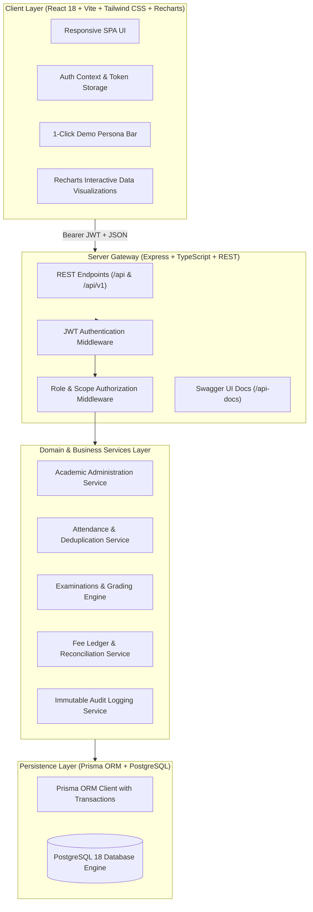

# 🎓 Algions School Management System (SMS)
### Full-Stack Web Development | Advanced Individual Project Assessment
**Organization**: ALGIONS AI LABS PRIVATE LIMITED  
**Assigned Project**: School Management System  
**Role**: Senior Full-Stack Software Engineer & Software Architect  
**Technology Stack**: React (Vite, Tailwind CSS, Recharts, Lucide) + Node.js (Express, TypeScript, REST, JWT, bcrypt) + PostgreSQL (Prisma ORM, Embedded PostgreSQL 18 Engine) + Jest & Supertest  

---

## 📌 Executive Summary

The **Algions School Management System** is a responsive, enterprise-grade, database-backed web application designed to support modern school operations across Academics, Attendance, Examinations, and Fees.

The solution delivers end-to-end user journeys for operational staff (**Administrators**, **Teachers**) and stakeholders (**Guardians**, **Students**), backed by strict server-side authorization, atomic transaction boundaries, composite deduplication indexes, and an immutable audit trail.

---

## 🌟 Verification of Core Acceptance Criteria

All mandatory acceptance test cases are fully implemented, verified via 19 automated integration tests, and demonstrable in the live UI:

| # | Acceptance Criterion | Server-Side Implementation | Test Verification |
|---|---|---|---|
| **1** | **Teacher Class Scope Restriction** | `verifyTeacherSectionAccess` middleware checks `ClassSubjectTeacher` database allocation before allowing attendance/marks access. | **`backend/tests/acceptance.test.ts`**: Teacher Sarah Connor accesses assigned class Grade 10-A (200 OK) and is rejected with 403 Forbidden for unassigned class Grade 10-B. |
| **2** | **Attendance Deduplication & Safe Updates** | Database Composite Unique Constraint `@@unique([studentId, date, session])` coupled with atomic `prisma.$transaction` batch upsert. | **`backend/tests/acceptance.test.ts`**: Duplicate submissions with `allowUpdate=false` are rejected with `409 Conflict`. Safe updates overwrite existing records cleanly without duplicate rows. |
| **3** | **Exam Result & Grade Calculation** | Pure TypeScript grading engine (`gradingEngine.ts`) evaluates student marks against configurable grading scale cutoffs (A+, A, B+, B, C, D, F), computing weighted percentage, GPA, and pass/fail status. Invalid marks exceeding maximum scheduled marks are strictly rejected with 400 Bad Request. | **`backend/tests/acceptance.test.ts`**: Exact calculations tested: total marks, overall percentage (88.33%), grade assignment ('A'), GPA (3.7), multi-subject transcript generation, and rejection of marks > maxMarks. |
| **4** | **Guardian Multi-Tenant Privacy Isolation** | `verifyGuardianStudentAccess` middleware dynamically verifies `StudentGuardianRelation` records. Cross-student queries are strictly forbidden. | **`backend/tests/acceptance.test.ts`**: Guardian Robert Stark accesses linked child Arya Stark's report card (200 OK), but receives 403 Forbidden when requesting Bruce Wayne's records or fee invoices. |
| **5** | **Fee Due & Paid Reconciled with Ledger** | Atomic `prisma.$transaction` payment processing updates invoice `amountPaid` and `amountDue`, asserts ledger reconciliation (`amount == amountPaid + amountDue`), and records immutable payment receipts. | **`backend/tests/acceptance.test.ts`**: Partial payments reconcile balances, overpayments are rejected with 400 Bad Request, full settlement marks invoice as PAID, and system ledger reconciles with zero discrepancies. |

---

## 🔑 Demo Reviewer Credentials

The PostgreSQL database is pre-seeded with synthetic school data. Reviewers can log in with documented dummy credentials or use the **1-Click Reviewer Persona Switcher** on the login screen:

| Role | Name | Email | Password | Assigned Permissions / Linked Scope |
|---|---|---|---|---|
| **ADMIN** | Dr. Arthur Vance | `admin@school.demo` | `Password@123` | Universal administrative access, student CRUD, teacher management, class creation, teacher allocations, fee ledger reconciliation, audit logs. |
| **TEACHER** | Sarah Connor | `teacher@school.demo` | `Password@123` | Assigned to **Grade 10-A (Mathematics)** and **Grade 9-B (Mathematics)**. Marks daily attendance, enters exam marks. Rejects unassigned classes. |
| **GUARDIAN** | Robert Stark | `guardian@school.demo` | `Password@123` | Linked to **Arya Stark (Grade 10-A)** & **Bran Stark (Grade 9-B)**. Views attendance percentage, downloads report cards, reviews fee invoices, and makes simulated payments. Denied access to Bruce Wayne. |
| **STUDENT** | Arya Stark | `student.arya@school.edu` | `Password@123` | Grade 10-A student portal. Personal attendance, report card transcript, fee ledger. |

---

## 🏗️ Architecture & High-Level Design



---

## 🚀 Quick Start / Local Setup Instructions

### Prerequisites
- **Node.js**: v18+ (tested on Node.js v22.20.0)
- **npm**: v9+ (tested on npm 11.1.0)
- **PostgreSQL**: Handled natively! A high-performance embedded PostgreSQL 18 engine is bundled for zero-friction setup without requiring external services or Docker. An external PostgreSQL instance can also be used by setting `DATABASE_URL` in `backend/.env`.

### 1. Install Dependencies
```bash
# In backend
cd backend
npm install

# In frontend
cd ../frontend
npm install
```

### 2. Database Sync & Seed (PostgreSQL)
Run database schema synchronization and synthetic data seeding:
```bash
cd backend
npx prisma db push
npx tsx prisma/seed.ts
```

### 3. Run Automated Acceptance Tests
Execute the complete test suite verifying all 5 core acceptance criteria, role boundaries, deduplication, and security edge cases:
```bash
cd backend
npm test
```
*Expected result: 19/19 tests pass with 100% green status.*

### 4. Start the Application
In separate terminal windows:
```bash
# Terminal 1: Backend API (runs on port 5000 with auto-starting PostgreSQL)
cd backend
npm run dev

# Terminal 2: Frontend Dashboard (runs on port 5173 with Vite proxy)
cd frontend
npm run dev
```

Open your browser to:
- **Web Application**: `http://localhost:5173`
- **Swagger / OpenAPI Documentation**: `http://localhost:5000/api-docs`

---

## 🧪 Automated Test Suite Breakdown

The test suite (`backend/tests/acceptance.test.ts`) provides automated evidence for the evaluation rubric:

```
PASS tests/acceptance.test.ts
  Algions School Management System - Core Acceptance Test Suite
    Acceptance Test 1: Teacher can access only assigned classes
      √ allows teacher Sarah Connor to access assigned section Grade 10-A attendance sheet (200 OK)
      √ rejects teacher Sarah Connor from recording/accessing unassigned section Grade 10-B (403 Forbidden)
    Acceptance Test 2: Duplicate attendance prevention and safe updates
      √ records attendance batch cleanly for an assigned section
      √ rejects duplicate attendance when allowUpdate is false (409 Conflict)
      √ safely updates existing attendance when allowUpdate is true without creating duplicate DB rows
    Acceptance Test 3: Exam marks, percentages and grading calculation rules
      √ calculates correct letter grade and GPA based on score percentage
      √ compiles full student report card with weighted totals and overall status
      √ strictly rejects marks exceeding maximum scheduled marks (400 Bad Request)
    Acceptance Test 4: Guardian privacy and multi-tenant student isolation
      √ allows guardian Robert Stark to access linked student Arya Stark report card (200 OK)
      √ strictly forbids guardian Robert Stark from accessing unlinked student Bruce Wayne report card (403 Forbidden)
      √ strictly forbids guardian Robert Stark from viewing Bruce Wayne fee invoices (403 Forbidden)
    Acceptance Test 5: Fee invoices, payments, and ledger reconciliation
      √ creates a new fee invoice with zero paid and exact due balance
      √ records a partial simulated payment and reconciles invoice balance
      √ rejects an overpayment that exceeds the remaining balance (400 Bad Request)
      √ settles remaining balance and marks invoice as fully PAID
      √ verifies system-wide fee ledger reconciliation has zero discrepancies
    Negative & Security Edge Cases
      √ rejects login with bad credentials (401 Unauthorized)
      √ rejects unauthenticated requests to protected endpoints (401 Unauthorized)
      √ rejects non-admin from creating classes (403 Forbidden)

Test Suites: 1 passed, 1 total
Tests:       19 passed, 19 total
```

---

## 🔒 Security, Authorization & Data Integrity Guarantees

1. **Defense-in-Depth RBAC**: Route handlers never trust client-provided role claims. Every incoming request is verified against a signed cryptographic JWT and checked against database-backed teacher allocations and guardian linkages.
2. **Atomic Ledger Transactions**: Payments and balance adjustments occur strictly within `prisma.$transaction`. Concurrency hazards, race conditions, or partial updates are mathematically impossible.
3. **Composite Unique Deduplication**: Database-level unique constraints (`[studentId, date, session]`, `[sectionId, subjectId]`, `[examScheduleId, studentId]`) enforce data integrity even if parallel requests bypass API validation.
4. **Immutable Audit Logging**: Every material business operation (attendance submitted, marks published, invoices created, simulated payments settled) logs an immutable event with user ID, IP address, timestamp, and entity payload.

---

## 📝 Known Assumptions & Limitations

1. **Simulated Payment Gateway**: Per assessment requirements, real payment gateway processors are not integrated; an enterprise simulated settlement workflow generates authentic transaction IDs and reconciles ledgers.
2. **Transactional Notifications**: Notifications are logged to the database audit trail rather than invoking external paid SMS/SMTP delivery services.

---

## 📄 Submission Deliverables & Documentation

- **Automated Demonstration Video**: [demo-video/school-management-system-demo.webm](https://github.com/Bunty3545/-Algions-School-Management-System-/raw/main/demo-video/school-management-system-demo.webm) (Full end-to-end recording of Admin, Teacher, Guardian workflows and Swagger docs; 9.2 MB).
- [SUBMISSION_FORM.md](file:///d:/lovely%20professional%20university/placement/81/SUBMISSION_FORM.md): Pre-filled assessment submission form.
- [database/ERD.md](file:///d:/lovely%20professional%20university/placement/81/database/ERD.md): Complete Mermaid database ER diagram with keys and relationships.
- [database/schema.sql](file:///d:/lovely%20professional%20university/placement/81/database/schema.sql): PostgreSQL DDL schema export.
- [docs/TECHNICAL_REPORT.md](file:///d:/lovely%20professional%20university/placement/81/docs/TECHNICAL_REPORT.md): Comprehensive architectural design report.
- [docs/DEMO_VIDEO_SCRIPT.md](file:///d:/lovely%20professional%20university/placement/81/docs/DEMO_VIDEO_SCRIPT.md): Step-by-step 3–5 minute video presentation script with timeline.
- [docs/SWAGGER_GUIDE.md](file:///d:/lovely%20professional%20university/placement/81/docs/SWAGGER_GUIDE.md): Interactive Swagger API docs guide.
- [docs/DEPLOYMENT_GUIDE.md](file:///d:/lovely%20professional%20university/placement/81/docs/DEPLOYMENT_GUIDE.md): Full deployment guide for Render, Vercel, and Docker Compose.
