# Entity Relationship Diagram (ERD) - School Management System

This document outlines the relational data model for the Algions School Management System backed by **PostgreSQL** and managed with **Prisma ORM**.

## Relational Entity-Relationship Diagram

```mermaid
erDiagram
    User ||--o| TeacherProfile : "has profile"
    User ||--o| GuardianProfile : "has profile"
    User ||--o| StudentProfile : "has user login"
    User ||--o{ AttendanceRecord : "recorded by"
    User ||--o{ ExamMark : "evaluated by"
    User ||--o{ FeePayment : "received by"
    User ||--o{ AuditLog : "performed action"

    AcademicClass ||--|{ Section : "contains sections"

    Section ||--|{ StudentProfile : "enrolled in"
    Section ||--o{ ClassSubjectTeacher : "assigned teachers"
    Section ||--o{ AttendanceRecord : "section attendance"
    Section ||--o{ ExamSchedule : "exam schedules"

    Subject ||--o{ ClassSubjectTeacher : "subject allocations"
    Subject ||--o{ ExamSchedule : "subject exams"

    TeacherProfile ||--o{ ClassSubjectTeacher : "assigned to"

    GuardianProfile ||--|{ StudentGuardianRelation : "guardian links"
    StudentProfile ||--|{ StudentGuardianRelation : "student links"

    StudentProfile ||--o{ AttendanceRecord : "daily attendance"
    StudentProfile ||--o{ ExamMark : "exam scores"
    StudentProfile ||--o{ FeeInvoice : "invoiced fees"

    GradingScale ||--|{ GradeRule : "defines rules"

    Exam ||--|{ ExamSchedule : "schedules"
    ExamSchedule ||--o{ ExamMark : "marks entered"

    FeeInvoice ||--o{ FeePayment : "payment ledger"

    User {
        string id PK
        string email UK
        string passwordHash
        string name
        string role "ADMIN | TEACHER | GUARDIAN | STUDENT"
        string phone
        string avatar
        boolean isActive
        datetime createdAt
        datetime updatedAt
    }

    TeacherProfile {
        string id PK
        string userId FK,UK
        string employeeId UK
        string specialization
        datetime joiningDate
        datetime createdAt
        datetime updatedAt
    }

    GuardianProfile {
        string id PK
        string userId FK,UK
        string relationship "PARENT | GUARDIAN"
        string occupation
        datetime createdAt
        datetime updatedAt
    }

    AcademicClass {
        string id PK
        string name UK "e.g. Grade 10"
        string code UK "e.g. G10"
        datetime createdAt
        datetime updatedAt
    }

    Section {
        string id PK
        string classId FK
        string name "e.g. A, B"
        string roomNumber
        int capacity
        datetime createdAt
        datetime updatedAt
    }

    Subject {
        string id PK
        string name "e.g. Mathematics"
        string code UK "e.g. MATH-10"
        string description
        datetime createdAt
        datetime updatedAt
    }

    ClassSubjectTeacher {
        string id PK
        string sectionId FK
        string subjectId FK
        string teacherProfileId FK
        string academicYear
        datetime createdAt
        datetime updatedAt
    }

    StudentProfile {
        string id PK
        string userId FK,UK
        string admissionNumber UK
        string firstName
        string lastName
        string dateOfBirth
        string gender
        int rollNumber
        string sectionId FK
        string status "ACTIVE | TRANSFERRED | GRADUATED"
        datetime createdAt
        datetime updatedAt
    }

    StudentGuardianRelation {
        string id PK
        string studentId FK
        string guardianProfileId FK
        boolean isPrimary
        datetime createdAt
    }

    AttendanceRecord {
        string id PK
        string studentId FK
        string sectionId FK
        string date "YYYY-MM-DD"
        string session "MORNING | AFTERNOON | FULL_DAY"
        string status "PRESENT | ABSENT | LATE | EXCUSED"
        string remarks
        string recordedById FK
        datetime createdAt
        datetime updatedAt
    }

    GradingScale {
        string id PK
        string name UK
        boolean isDefault
        datetime createdAt
        datetime updatedAt
    }

    GradeRule {
        string id PK
        string gradingScaleId FK
        string grade "A+, A, B+, B, C, D, F"
        float minScore
        float maxScore
        float gradePoint
        string description
    }

    Exam {
        string id PK
        string title "Midterm Examination 2025"
        string term "Term 1"
        string academicYear
        string startDate
        string endDate
        string status "SCHEDULED | ONGOING | COMPLETED | PUBLISHED"
        datetime createdAt
        datetime updatedAt
    }

    ExamSchedule {
        string id PK
        string examId FK
        string sectionId FK
        string subjectId FK
        string examDate
        float maxMarks
        float passMarks
        datetime createdAt
        datetime updatedAt
    }

    ExamMark {
        string id PK
        string examScheduleId FK
        string studentId FK
        float marksObtained
        boolean isAbsent
        string remarks
        string evaluatedById FK
        datetime createdAt
        datetime updatedAt
    }

    FeeInvoice {
        string id PK
        string invoiceNumber UK
        string studentId FK
        string title
        string category
        float amount
        float amountPaid
        float amountDue
        string dueDate
        string status "PENDING | PARTIALLY_PAID | PAID | OVERDUE"
        string notes
        datetime createdAt
        datetime updatedAt
    }

    FeePayment {
        string id PK
        string paymentNumber UK
        string invoiceId FK
        float amount
        string paymentMethod "ONLINE_SIMULATED | CASH | BANK_TRANSFER"
        string referenceNote
        string transactionId
        datetime paidAt
        string receivedById FK
    }

    AuditLog {
        string id PK
        string userId FK
        string action "e.g. USER_LOGIN, PAYMENT_RECORDED"
        string entityType "e.g. User, Attendance, FeePayment"
        string entityId
        string details
        string ipAddress
        datetime createdAt
    }
```

## Key Database Constraints & Integrity Rules

1. **Unique Attendance Enforcement**:
   - `@@unique([studentId, date, session])` on `AttendanceRecord`.
   - Prevents duplicate attendance entries for any student on the same calendar day and session.

2. **Teacher Allocation Isolation**:
   - `@@unique([sectionId, subjectId])` on `ClassSubjectTeacher`.
   - Explicit relational binding between teachers, class sections, and subjects.

3. **Multi-Tenant Guardian Privacy**:
   - `@@unique([studentId, guardianProfileId])` on `StudentGuardianRelation`.
   - Server-side RBAC middleware validates guardian relations before permitting access to report cards, attendance, and fee invoices.

4. **Fee Reconciliation Guarantees**:
   - `amountDue = amount - amountPaid`.
   - Payment operations are wrapped in PostgreSQL ACID transactions (`prisma.$transaction`) with optimistic locking on balance integrity.

