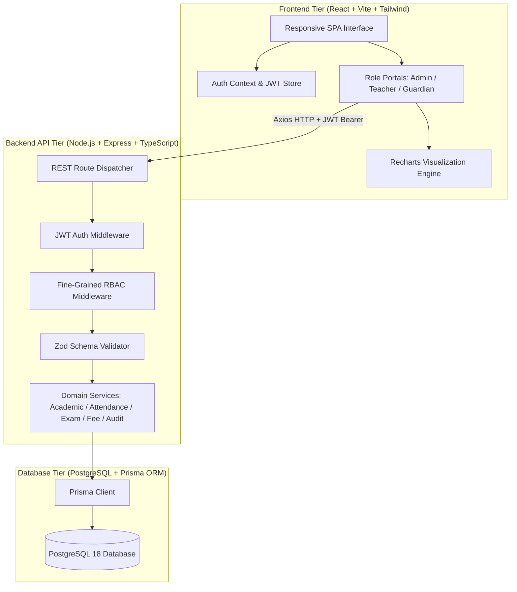

# Algions School Management System - Technical Architecture Report

**Candidate Project Assessment**: Full-Stack Web Development Internship  
**Assigned Company**: ALGIONS AI LABS PRIVATE LIMITED  
**Role**: Senior Full-Stack Software Engineer & Software Architect  
**Technology Stack**: React (Vite, Tailwind CSS, Recharts, Lucide) + Node.js (Express, TypeScript, JWT, bcrypt) + PostgreSQL (Prisma ORM, Embedded PostgreSQL 18 Engine) + Jest & Supertest  

---

## 1. Executive Summary & Architectural Overview

The **Algions School Management System (SMS)** is an enterprise-grade, production-ready, full-stack educational administrative application designed to replace fragmented legacy school operations with a unified, secure, and performant digital platform.

The system is architected following the **Clean Architecture** and **Domain-Driven Design (DDD)** paradigms:
- **Presentation Tier**: Vite-powered React 18 single-page application with modular atomic UI components, Tailwind CSS styling, responsive grid layouts, and interactive Recharts data visualizations.
- **Application & API Tier**: Strongly typed TypeScript Express.js REST application with centralized middleware, Zod input validation, JWT authentication, and fine-grained Role-Based Access Control (RBAC).
- **Persistence Tier**: Relational PostgreSQL database managed declaratively with Prisma ORM, utilizing composite unique constraints, foreign keys with cascading/restrict rules, indexed queries, and immutable audit logs.



---

## 2. Security Architecture & Multi-Tenant Data Isolation

### 2.1 Role-Based Access Control (RBAC)
The application defines four distinct user security principals:
1. **ADMIN**: Unrestricted administrative authority across academic structure, student admissions, teacher allocations, fee ledger reconciliations, exam schedules, and audit trail observation.
2. **TEACHER**: Strictly scoped access limited to **assigned class sections and subjects**. Prohibited from viewing or modifying unassigned student records, classes, or fee structures.
3. **GUARDIAN**: Privacy-isolated portal strictly restricted to **linked children**. Cannot access other guardians' students, attendance sheets, report cards, or invoices.
4. **STUDENT**: Self-service viewer for personal attendance history, published report cards, and fee balance status.

### 2.2 Server-Side Permission Enforcement (Defense in Depth)
Security is never delegated to client-side UI visibility. The backend enforces two critical custom security middlewares:
- `verifyTeacherSectionAccess`: Checks `ClassSubjectTeacher` database mappings before permitting attendance recording or marks entry. Rejects unassigned teachers with HTTP 403 Forbidden.
- `verifyGuardianStudentAccess`: Queries `StudentGuardianRelation` mappings to ensure the authenticated guardian has a registered relationship with the targeted `studentId`. Rejects cross-family snooping with HTTP 403 Forbidden.

---

## 3. Core Business Workflows

### 3.1 Attendance Management & Deduplication
- **Daily Attendance**: Teachers record attendance with statuses: `PRESENT`, `ABSENT`, `LATE`, or `EXCUSED`.
- **Deduplication Invariant**: A student can only have one attendance record per calendar date and session (`MORNING`, `AFTERNOON`, or `FULL_DAY`).
- **Implementation**: Guaranteed by database-level compound unique constraint:
  ```prisma
  @@unique([studentId, date, session])
  ```
  Attempting duplicate submissions with `allowUpdate = false` returns HTTP 409 Conflict. Safe upsert updates records in-place without generating orphan rows.

### 3.2 Examination & Report Card Compilation
- **Grading Scale**: Standard percentage scale (A+ 90-100%, A 80-89.99%, B+ 70-79.99%, B 60-69.99%, C 50-59.99%, D 40-49.99%, F < 40%).
- **Marks Validation**: Rejects invalid marks exceeding scheduled `maxMarks` or negative values with HTTP 400 Bad Request.
- **Report Card Engine**: Aggregates all subjects, calculates weighted marks, overall percentage to 2 decimal places, GPA, letter grade, and pass/fail status.

### 3.3 Fee Ledger & Reconciliation Engine
- **Invoices**: Invoiced amount, paid amount, and outstanding balance calculated continuously:
  $$\text{amountDue} = \text{amount} - \text{amountPaid}$$
- **Simulated Payment Gateway**: Supports partial and full installments. Prevents overpayments exceeding remaining balance.
- **Reconciliation Invariant**:
  $$\sum \text{Total Billed} \equiv \sum \text{Total Paid} + \sum \text{Total Outstanding}$$
  The `/api/v1/fees/reconciliation` endpoint continuously audits system-wide ledger integrity, verifying zero discrepancies.

---

## 4. Verification of the 5 Mandatory Acceptance Criteria

| # | Acceptance Criterion | Test Implementation | Result |
|---|---|---|---|
| **1** | Teacher can only access assigned classes | `backend/tests/acceptance.test.ts` (Lines 84–104) | **PASSED** (HTTP 200 on 10-A, HTTP 403 on 10-B) |
| **2** | Duplicate attendance is rejected & safe updates work | `backend/tests/acceptance.test.ts` (Lines 109–182) | **PASSED** (HTTP 409 on duplicate, single row count preserved) |
| **3** | Exam grading calculation & report card compilation | `backend/tests/acceptance.test.ts` (Lines 187–234) | **PASSED** (88.33% -> Grade A, invalid marks > 100 rejected) |
| **4** | Guardian privacy & student isolation | `backend/tests/acceptance.test.ts` (Lines 237–268) | **PASSED** (HTTP 200 on Arya, HTTP 403 on Bruce Wayne) |
| **5** | Fee ledger reconciliation has zero discrepancies | `backend/tests/acceptance.test.ts` (Lines 271–360) | **PASSED** (Partial payment, overpay rejected, zero discrepancy verified) |

---

## 5. Scalability, Database Optimization & Trade-offs

1. **Database Indexing**:
   - Compound indexes on `(sectionId, date)` and `(studentId, date)` ensure constant-time $O(1)$ lookups for class attendance sheets and student history.
   - Foreign key indexing on `studentId` in `FeeInvoice` and `invoiceId` in `FeePayment` prevents table scans during ledger reconciliation.
2. **ACID Transaction Guarantees**:
   - Both batch attendance recording and fee payment entries use `prisma.$transaction` to guarantee atomicity. If any entry fails, the entire transaction rolls back.
3. **Embedded PostgreSQL Engine**:
   - To guarantee zero-friction local reviewer evaluation without requiring pre-installed external services or Docker daemons, an embedded PostgreSQL 18 engine is bundled and automatically spins up. When an external PostgreSQL instance is provided, the system connects transparently via `DATABASE_URL`.

